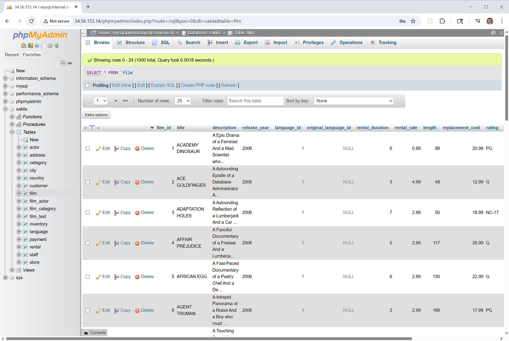
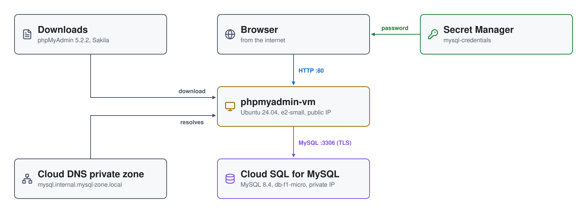

# MySQL on GCP: Cloud SQL for MySQL with phpMyAdmin

A private **Cloud SQL for MySQL** instance, built with Terraform and loaded
with the [Sakila](https://dev.mysql.com/doc/sakila/en/) sample database. The
instance has no public IP; a **phpMyAdmin** VM with a public IP gives you a
browser client for it.



| Piece | Where | Role |
|---|---|---|
| **Cloud SQL for MySQL** | private IP, peered to `mysql-vpc` | `mysql-instance`, MySQL 8.4, `db-f1-micro`, automated backups, Sunday 03:00 maintenance window; no public IP |
| **Private service access** | `mysql-vpc` | a reserved /16 range peered to Google's service network, which is where the instance's private IP comes from |
| **Cloud DNS private zone** | visible to `mysql-vpc` | `internal.mysql-zone.local`, with `mysql.internal.mysql-zone.local` pointing at the instance |
| **phpmyadmin-vm** | `mysql-subnet`, public IP | Ubuntu 24.04, `e2-small`, `us-central1-a`; loads Sakila, then serves phpMyAdmin 5.2.2 |
| **Secret Manager** | global | `mysql-credentials`: the `sysadmin` user and password |

## Architecture

<picture>
  <source media="(prefers-color-scheme: dark)" srcset="architecture-dark.svg">
  
</picture>

Regenerate with `python3 make_diagram.py`.

- **`01-mysql/`** is the whole stack: the VPC (`mysql-vpc`) with
  `mysql-subnet` (10.0.0.0/24), the firewall rules, the private service
  access range and peering, the Cloud SQL instance and its `sysadmin` user,
  the private DNS zone, the secret, and the phpMyAdmin VM.

## How it boots

1. Terraform builds the VPC and the private service access peering, then
   waits 5 minutes for the peering to propagate before creating the Cloud SQL
   instance. It generates a 24-character password for the `sysadmin` user.
2. The VM's startup script installs Apache, PHP and the MySQL client,
   downloads phpMyAdmin 5.2.2, and points it at
   `mysql.internal.mysql-zone.local` over TLS (`ssl = true`, certificate not
   verified). `/` redirects to `/phpmyadmin`.
3. It downloads Sakila from dev.mysql.com and loads the schema and data, then
   creates phpMyAdmin's own configuration tables in a `phpmyadmin` database.

## Firewall rules

```
internet ─80, 22─▶ phpmyadmin-vm ─3306─▶ Cloud SQL (peered private IP)
```

| Rule | Port | Applies to |
|---|---|---|
| `mysql-allow-http` | tcp 80 | phpmyadmin-vm |
| `mysql-allow-ssh` | tcp 22 | phpmyadmin-vm |

Both allow `0.0.0.0/0`. The Cloud SQL instance has no public IP, so it can
only be reached from inside the VPC.

## Prerequisites

* [A Google Cloud Account](https://console.cloud.google.com/)
* [Install gcloud CLI](https://cloud.google.com/sdk/docs/install)
* [Install Terraform](https://developer.hashicorp.com/terraform/install)
* [Install jq](https://jqlang.github.io/jq/download/)

Put a service account key in the repository root as `credentials.json`.
Terraform uses it, and `check_env.sh` activates it and runs `api_setup.sh`,
which enables the Cloud SQL Admin, Service Networking, Compute and other APIs
the build needs. If this is your first time watching our content, we
recommend starting with this video:
[GCP + Terraform: Easy Setup](https://youtu.be/3spJpYX4f7I).

## Deploy

```bash
git clone https://github.com/mamonaco1973/gcp-mysql.git
cd gcp-mysql
./apply.sh       # one phase: VPC, peering, Cloud SQL, DNS, secret, phpMyAdmin VM
```

Everything deploys to `us-central1`. `apply.sh` ends by running
`validate.sh`, which waits for phpMyAdmin to answer (up to 15 minutes) and
prints:

```
===============================================================================
BUILD RESULTS
===============================================================================
phpMyAdmin URL        : http://203.0.113.10
MySQL Hostname (DNS)  : mysql.internal.mysql-zone.local
===============================================================================
```

## Try it

1. Get the password from Secret Manager:

   ```bash
   gcloud secrets versions access latest --secret=mysql-credentials \
     | jq -r .password
   ```

2. Open the phpMyAdmin URL and sign in as `sysadmin`. The `sakila` database
   is in the tree on the left.
3. Run the sample queries from the **SQL** tab:

   ```sql
   SELECT
       f.title AS film_title,
       CONCAT(a.first_name, ' ', a.last_name) AS actor_name
   FROM sakila.film f
   JOIN sakila.film_actor fa ON f.film_id = fa.film_id
   JOIN sakila.actor a ON fa.actor_id = a.actor_id
   ORDER BY f.title, actor_name
   LIMIT 20;
   ```

   ```sql
   SELECT
       f.title,
       GROUP_CONCAT(
           CONCAT(a.first_name, ' ', a.last_name)
           ORDER BY a.last_name
           SEPARATOR ', '
       ) AS actor_names
   FROM sakila.film f
   JOIN sakila.film_actor fa ON f.film_id = fa.film_id
   JOIN sakila.actor a ON fa.actor_id = a.actor_id
   GROUP BY f.title
   ORDER BY f.title
   LIMIT 10;
   ```

## Troubleshooting

| Symptom | Fix |
|---|---|
| `validate.sh` keeps retrying | The VM is still installing. `gcloud compute ssh phpmyadmin-vm --zone us-central1-a`, then `sudo journalctl -u google-startup-scripts`. |
| `sakila` is missing | The load runs at the end of the startup script; look for `mysql` errors in the same journal. |
| phpMyAdmin can't reach the server | `nslookup mysql.internal.mysql-zone.local` on the VM should return the instance's private IP. |
| You want a local client | The instance is private. Connect from the VM (`mysql -h mysql.internal.mysql-zone.local -u sysadmin -p`). |

## Teardown

```bash
./destroy.sh     # deletes the Cloud SQL instance with gcloud first, then destroys the stack
```

The instance is deleted first so that Terraform can then remove the private
service access peering.

## Notes

- **Lab only.** phpMyAdmin is open to the internet over plain HTTP, SSH is
  open from anywhere, the database password is in the VM's startup script
  metadata, and the VM runs as the same service account as Terraform with
  the `cloud-platform` scope. Restrict the firewall rules and use a narrower
  VM service account for anything more.
